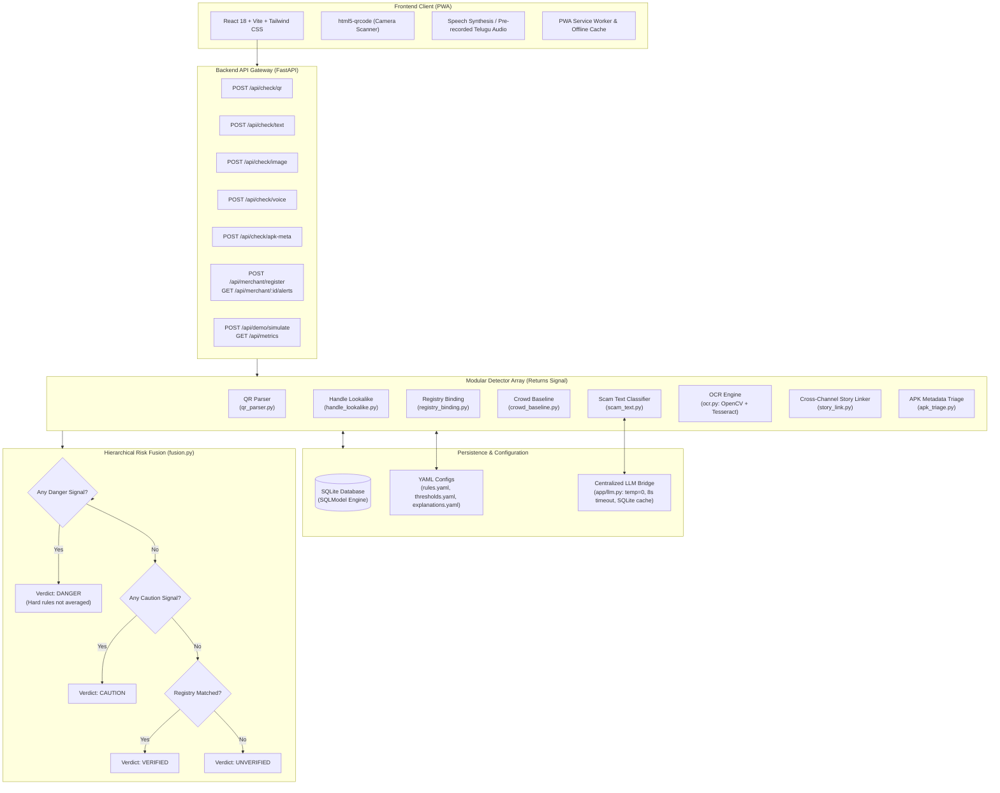
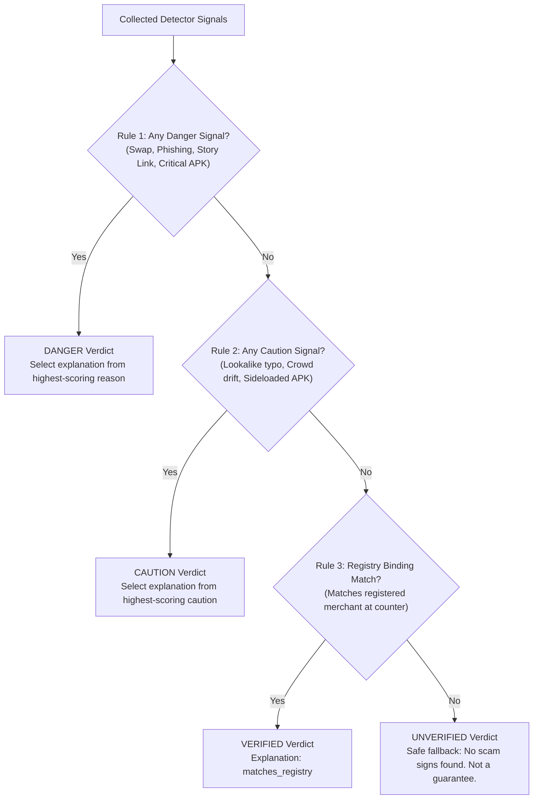
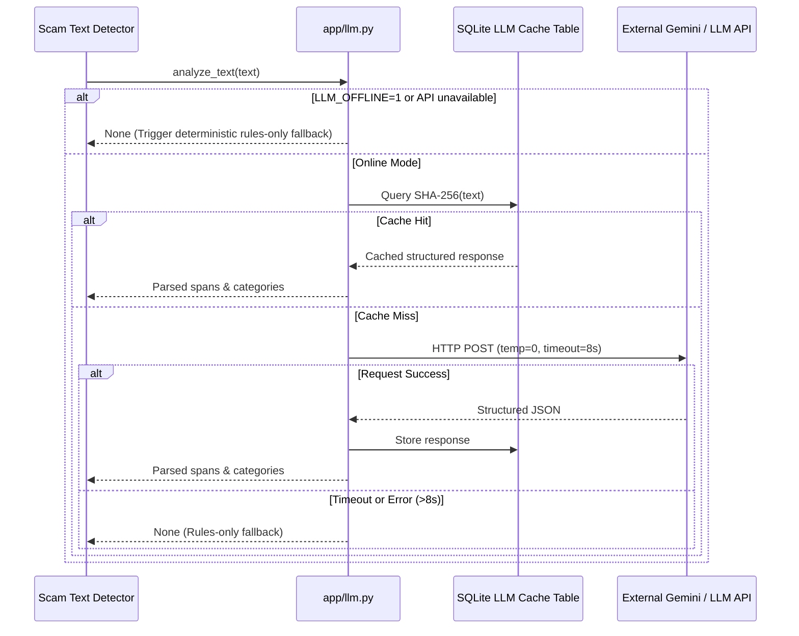
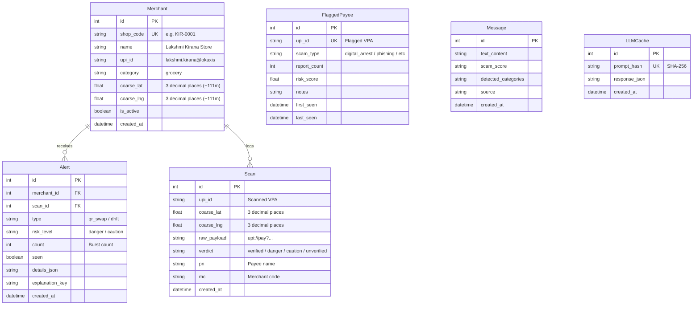

# QRaksha-Kavach System Architecture

QRaksha-Kavach ("Check Before You Pay") is an accessible Progressive Web Application (PWA) designed for small merchants, elderly users, and first-time smartphone users in Andhra Pradesh and Telangana.

The system connects suspicious digital content (SMS scams, chat lures, screenshots, voice notes, and APK metadata) with physical and digital payment destinations (UPI QR codes and VPAs) to produce **one unified, deterministic safety verdict**.

---

## 1. High-Level System Architecture

---

## 2. Specialized Detection Modules

All detectors strictly return the unified `Signal` object defined in `SPEC.md` Section 4.2 (`severity`: `ok` | `caution` | `danger`, `score`: $0.0 \dots 1.0$, `evidence`: `list[str]`, `explanation_key`: `str`).

| Detector | Module | Input | Responsibility & Algorithm |
| :--- | :--- | :--- | :--- |
| **QR Parser** | `qr_parser.py` | Raw QR string | Validates `upi://pay` scheme, extracts parameters (`pa`, `pn`, `am`, `mc`), checks required fields. |
| **Handle Lookalike** | `handle_lookalike.py` | VPA handle | Validates known PSP suffixes, detects brand impersonation (e.g. `sbi`, `gpay`), leetspeak digit substitution (`0`->`o`), and edit-distance typos with RapidFuzz. |
| **Registry Binding** | `registry_binding.py` | VPA + Coordinates / Shop Code | Computes pure Python Haversine distance ($R = 6,371 \text{ km}$) against registered kirana merchants ($\le 100\text{ m}$). Matches counter VPA or triggers instant DANGER and rate-limited merchant alert. |
| **Crowd Baseline** | `crowd_baseline.py` | VPA + Coarse Coordinates | Groups historical scans in 3-decimal grid cells (~111 m). If $\ge 8$ scans share $\ge 70\%$ dominance and a new payee appears, returns CAUTION (never danger). |
| **Scam Text** | `scam_text.py` | Message text / SMS | Dual-layer classifier: Evaluates 11 weighted categories ($1 - \prod(1 - w_i)$), 6-word negation window, and centralized LLM fallback with offline support. |
| **Image & OCR** | `ocr.py` | Image / Screenshot | Decodes embedded QR codes using headless OpenCV first; falls back to Tesseract OCR with English and Telugu (`eng+tel`) language packs. |
| **Story Linker** | `story_link.py` | VPA / URL + DB Session | Correlates payment destinations with previously reported scam content. Flagged VPAs trigger DANGER with direct citations and report timestamps. |
| **APK Metadata Triage** | `apk_triage.py` | Static JSON metadata | Evaluates app lures (`challan`, `kisan`, `update`), critical permissions (`BIND_ACCESSIBILITY_SERVICE`, `BIND_DEVICE_ADMIN`), and untrusted sideload channels. Never runs binaries. |

---

## 3. Hierarchical Risk Fusion Engine

The fusion engine (`backend/app/fusion.py`) enforces strict priority rules so that hard security signals cannot be diluted or averaged away:

---

## 4. Centralized LLM Architecture & Offline Resilience

All LLM calls are strictly gated through `backend/app/llm.py` to prevent prompt leakage, unverified safety advice, or external API failures:

---

## 5. Database Schema & Data Models

Persistence is implemented with SQLModel (SQLite). Exact coordinates, UPI PINs, and authentication secrets are **never** stored.

---

## 6. Privacy & Safety Commitments

1. **Zero Credential Collection**: The system never prompts for, reads, or stores UPI PINs, OTPs, or net banking passwords.
2. **Coarse Location Grid**: Only coordinates rounded to 3 decimal places (~111 meters) are retained for registry distance and crowd baseline clustering.
3. **Static Metadata Triage Only**: Untrusted APK files are analyzed strictly from static metadata JSON (`file_name`, `package_name`, `permissions`, `source`). Binaries are never executed.
4. **Predefined Explanations**: Safety advice is locked inside `app/config/explanations.yaml`. LLMs are never permitted to generate advice that could mislead vulnerable users.
